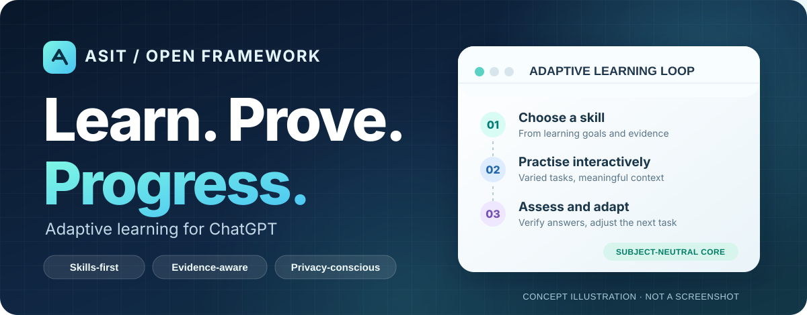
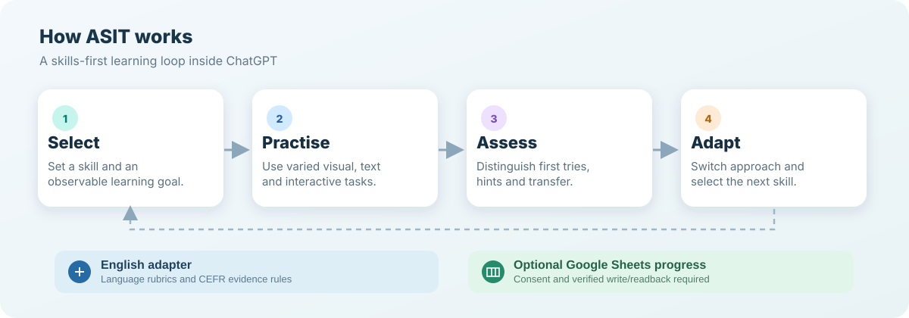

# ASIT — адаптивное обучение в ChatGPT

**ASIT — открытый skills-first фреймворк для персонализированного обучения через ChatGPT.** Первый предметный модуль — английский язык. Архитектура разделяет общий цикл обучения и предметную методику.

[English README](README.md) · [Архитектура](docs/ARCHITECTURE.md) · [Начало работы](docs/GETTING-STARTED.md) · [План развития](docs/ROADMAP.md) · [Участие в разработке](CONTRIBUTING.md)

> **Статус:** в репозитории находится **кандидат v0.3.0**. Код на GitHub не равен установленной версии плагина. Статические тесты не подтверждают работу аудио, UI или сохранения прогресса в реальном ChatGPT.

## Возможности

- **Адаптивное обучение:** выбор навыка, чередование учебных операций, смена механики после повторных ошибок.
- **Интерактивная практика:** работа с текстом, выбор вариантов, визуальные и коммуникативные задачи средствами интерфейса ChatGPT.
- **Оценивание по доказательствам:** учёт первого ответа, исправлений, подсказок и самостоятельного применения знаний.
- **Английский язык:** предметные критерии, осторожная аналитика по CEFR, инструкции по аудированию и голосовой практике.
- **Google Sheets — по желанию:** хранение прогресса только с разрешения пользователя и подтверждением записанных данных.

## Как устроен проект



*Концептуальная схема, не скриншот установленного плагина.*

Текущая реализация **skills-only**: без обязательного MCP, выделенного сервера или исполняемого JS-движка. Изменения в GitHub сами по себе не обновляют установленный плагин.

## Разработка

```bash
git clone https://github.com/tim8es/ASIT.git
cd ASIT
python3 -m unittest discover -s plugin/tests -p 'test_*.py'
python3 plugin/scripts/package.py --check
python3 plugin/scripts/package.py --output dist/ASIT_Skills_Plugin.zip
```

Собранный архив предназначен для **отдельной процедуры установки и проверки**. Инструкции: [Getting started](docs/GETTING-STARTED.md), [plugin/DEVELOPMENT.md](plugin/DEVELOPMENT.md).

## Ограничения и развитие

Нельзя считать, что Google Sheets сохраняет результат без авторизованного подключения и проверки чтением. CEFR-оценка не должна присваиваться по навыкам, которые система фактически не наблюдала. Аудио требует настоящего материала и проверенного воспроизведения.

Планируемые улучшения и критерии качества — в [Roadmap](docs/ROADMAP.md); перед открытием публичного доступа обязательно выполнить [чек-лист публикации](docs/PUBLISHING.md).

Мы приветствуем проверки UX, документацию, тест-кейсы и предложения для новых предметных адаптеров. [Как участвовать](CONTRIBUTING.md) · [MIT License](LICENSE).
